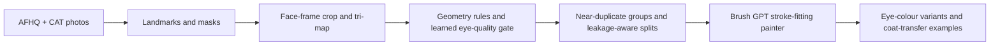
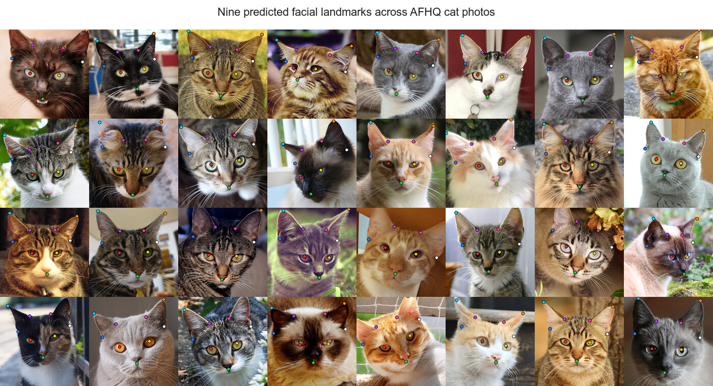
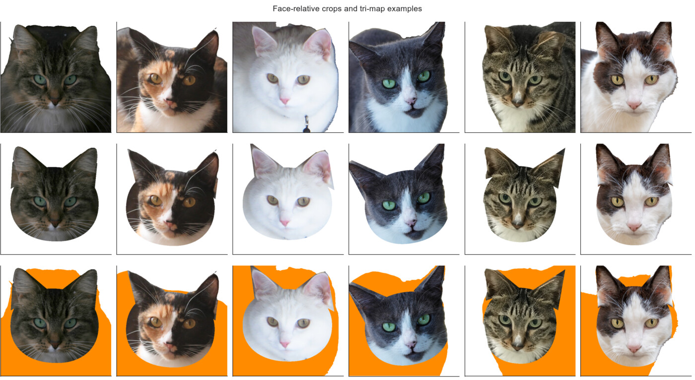
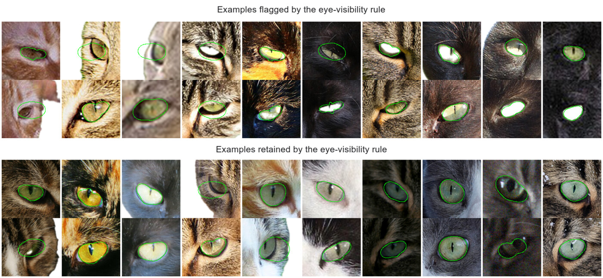
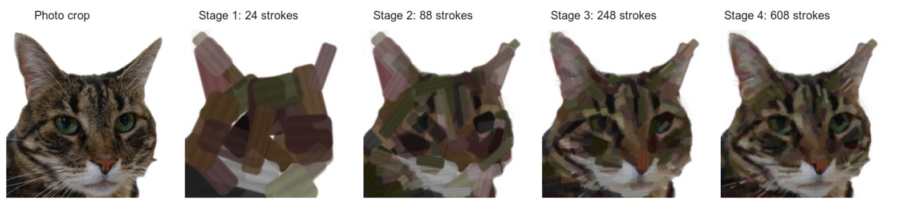
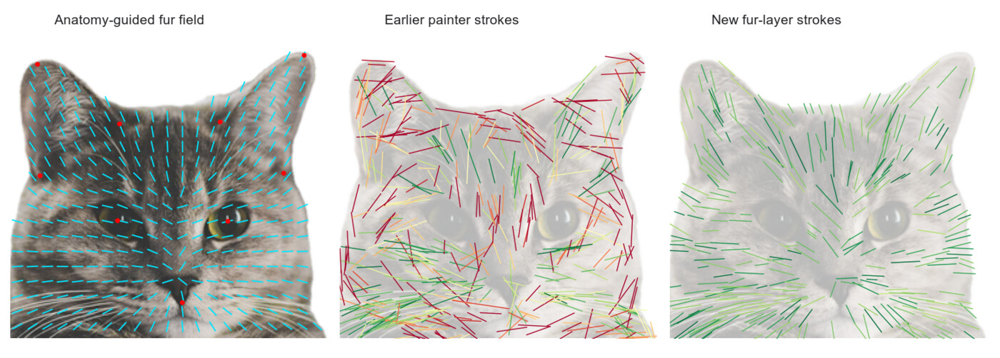
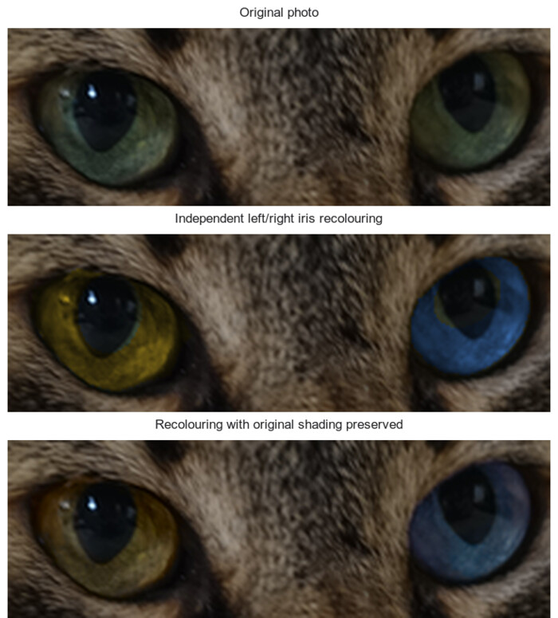
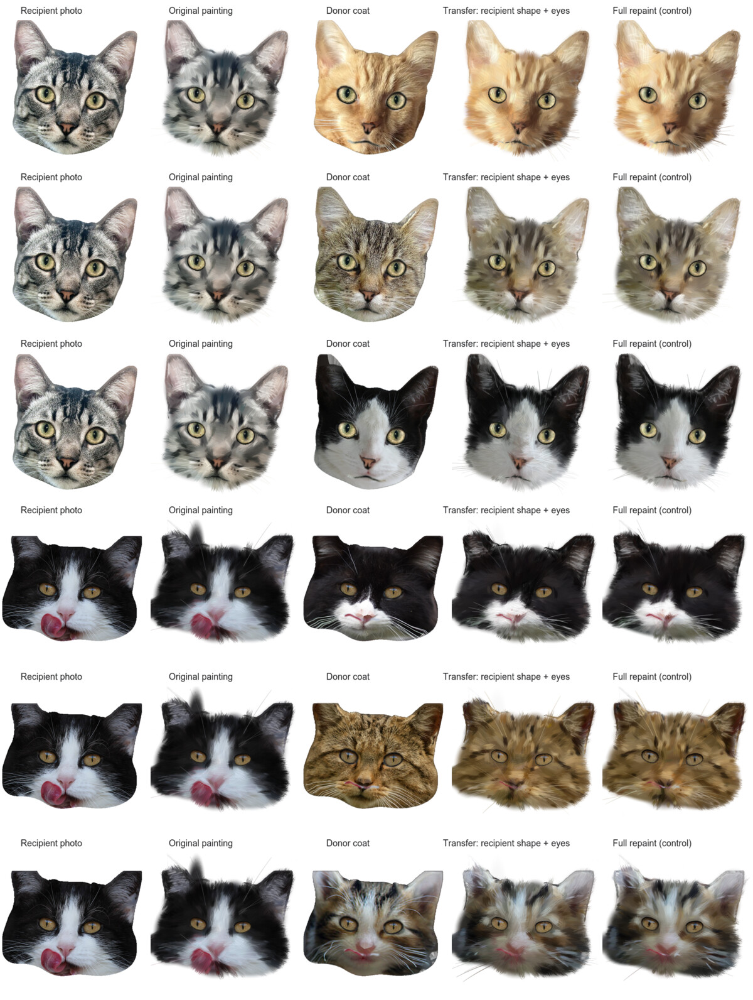

# Photo-to-Painting Dataset

[](https://github.com/alina0607/photo-to-painting-dataset/actions/workflows/ci.yml)

A data-curation pipeline for a cat-portrait painting system that represents paintings as ordered brush strokes. The collection contains 15,512 photos from AFHQ v2 (5,558) and the CAT dataset (9,954). The pipeline prepares face geometry, applies part-specific quality checks, finds near-duplicates, and supports leakage-aware evaluation. General-purpose blur and yellow-colour-cast detectors are not implemented yet.

> **Scope and attribution:** this repository implements face preparation, deterministic quality checks, eye-quality evaluation, duplicate grouping, and painting-integrity checks. The companion painter and coat-transfer prototype are in [Brush GPT](https://github.com/alina0607/brush-gpt) and [BidGPT](https://github.com/alina0607/BidGPT). CLIP and SAM pretrained weights and third-party libraries are reused; the feature pipelines, logistic-regression classifier, sketch-planning integration, stroke-fitting painter, and coat-transfer orchestration are project code. Coat-transfer examples exist; full-scale data generation and a learned interactive edit model remain in progress.

## Workflow



| Stage | Implementation | Purpose |
|---|---|---|
| Source photos | AFHQ v2 cat faces; CAT photos with subject masks and hand-placed landmarks | Combine aligned crops with labeled geometry |
| Landmark transfer | [Cat Face Landmarks](https://github.com/alina0607/cat-face-landmarks) | Predict eyes, mouth, and three points per ear for AFHQ images |
| Face preparation | [`photo2painting.ingest`](photo2painting/ingest.py) | Build face-relative crop and background/head/uncertain tri-map at 256 × 256 |
| Geometric rules | [`photo2painting.rules`](photo2painting/rules.py) | Detect cut-off faces, weak masks, small/low-contrast eyes, and missing ears |
| Eye-quality classifier | [`photo2painting.eye_quality`](photo2painting/eye_quality.py) | Combine CLIP crop embeddings and measured eye features with project-trained logistic regression |
| Label reliability | [`photo2painting.agreement`](photo2painting/agreement.py) | Measure annotator agreement with Cohen’s kappa |
| Duplicate control | [`photo2painting.duplicates`](photo2painting/duplicates.py) | Group near-identical photos and keep each group in one split |
| Painting integrity | [`photo2painting.integrity`](photo2painting/integrity.py) | Detect canvases or strokes with NaN or infinite values |

## 1. Transfer facial geometry to new photos

CAT has nine hand-placed points per image; AFHQ has aligned 512 × 512 cat-face crops but no landmarks. [Cat Face Landmarks](https://github.com/alina0607/cat-face-landmarks) implements a PyTorch Vision Transformer and masked-autoencoder (MAE) pretraining/fine-tuning pipeline based on published ViT/MAE methods; this is not a downloaded pretrained landmark model. It pretrains the encoder on unlabeled cat faces, fine-tunes on CAT’s labeled faces, and predicts left/right eye, mouth, and outer-base/tip/inner-base points for each ear.



On a held-out 1,000-image CAT test split, MAE pretraining improved normalized mean error from 0.0780 to 0.0670 and failure rate from 21.4% to 12.2%, versus the same model trained from random initialization. It does not predict the nose or classify image quality.

The project-written planner in [Brush GPT `plan.py`](https://github.com/alina0607/brush-gpt/blob/main/brushgpt/plan.py) prepares crops/prompts, calls Meta’s pretrained SAM model (`facebook/sam-vit-base`) through Hugging Face Transformers for prompted eye/nose masks, then processes contours into a sketch plan. SAM weights and Transformers are external; prompt, crop, contour, and planning logic are project code. Mouth structure is derived from the image.

## 2. Normalize framing without rotating the source

The eye midpoint is the origin, the eye line defines horizontal, and the mouth defines downward direction. The source photo is not rotated. A rounded head shape from landmarks is intersected with the subject mask and used for a 256 × 256 crop with a tri-map: `0` background (replaced with white paper), `1` cat head, and `2` uncertain pixels (mask outside the head shape or areas beyond the source image).



## 3. Filter photos for each modeled part

Eligibility is tracked separately for the full head, each ear, eyes, nose/mouth, and fur. A photo may be useful for one modeled part but not another.

### Deterministic geometry and visibility

Implemented checks include at least 97% face-hull coverage by the subject mask, at least 40 px between eyes, at least 0.035 luminance standard deviation near the eyes, and ear bases at least 20 px wide with the relevant region present. These detect incomplete framing, face areas that would become white paper, hidden/small ears, undersized eyes, and insufficient eye contrast.



### Learned eye-quality filter

A person labels eyes as clear or unclear. Project-written features combine frozen OpenAI CLIP (`openai/clip-vit-base-patch32`) embeddings from three eye crops (both eyes and each eye separately) with measured eye size, left/right size imbalance, iris lightness/colour differences, and pupil contrast. A project-trained scikit-learn logistic-regression classifier estimates whether eyes are unclear. The CLIP encoder is external and frozen, not trained in this project. Project code implements crop generation, feature assembly, labeling, evaluation, and threshold analysis. Stratified cross-validation produces out-of-fold scores, threshold selection is nested in training folds, and bootstrap intervals quantify uncertainty. Labels include grainy eyes, flash eye-shine, a hidden eye, grayscale, small squinted eyes, and shadows causing disagreement between eyes.

A historical five-fold evaluation on 435 hand-labeled cats recorded 0.795 accuracy and 0.890 ROC AUC. This is a CLIP-feature-plus-measurements classifier, **not** a separately trained deep-learning quality model.

The existing eye-visibility examples above show rule outcomes, not the classifier’s evaluation set. General blur and yellow-cast filters still need labels and evaluation.

## 4. Prevent duplicate-photo leakage

Candidate pairs come from thumbnail correlation (including mirrored images), DCT perceptual-hash distance, and optionally CLIP similarity. Candidates are scale/shift aligned and compared with normalized cross-correlation, SSIM, and RGB difference. Confirmed copies are grouped, and each group remains in one data split so near-copies cannot leak across train/validation/test.

## 5. Paint and create controlled variations

[Brush GPT](https://github.com/alina0607/brush-gpt) contains a project-written differentiable painter that fits parameterized strokes to a cat photo. Seven stages build the block-in, eyes, form, edges, markings, nose/mouth, and ears/whiskers; gradient descent fits stroke position, size, angle, colour, and opacity through the renderer. The Brush GPT transformer is implemented in PyTorch.



The project-written **fur-direction field** combines an anatomy prior (radiating from the nose, following the face around the eyes, pointing outward through ears) with local hair texture measured using a structure tensor. Doubled-angle vectors represent undirected brush strokes. Near eyes and nose, local image structure guides the field instead of treating facial texture as fur.



### Eye-colour counterfactuals

Brush GPT recolours the left and right eyes independently using colour measurements from labeled real cat eyes. It changes iris hue while retaining the original lightness and shading, then refits only eye layers. Pixels outside the eyes remain unchanged. Controlled variants and mirrored examples add training sequences without misrepresenting them as new source photos.



### Cross-cat coat-transfer prototype

A working prototype in [BidGPT `coat_versions.py`](https://github.com/alina0607/BidGPT/blob/main/ml/tools/coat_versions.py) creates donor-coat examples. A piecewise-affine warp places donor fur on a recipient, anchored by eyes, mouth, and sampled head/ear outline. It excludes donor facial features and background, preserving the recipient’s eyes, nose, and mouth. The prototype retains the original painting’s shape-layer stroke geometry and eye strokes, refits retained shape colours, repaints transferred fur, and produces a full-repaint control. It is implemented for examples; broader dataset generation and a learned interactive edit model remain in progress. This code is in BidGPT, not this curation package.



The learned generator separately supports coat-base and coat-pattern conditions. It is not yet a completed model that reliably applies an arbitrary donor coat to any cat.

## Data sources and licenses

| Source | Photos used | Annotations | Terms |
|---|---:|---|---|
| [AFHQ v2](https://github.com/clovaai/stargan-v2), cats | 5,558 aligned face crops | Landmarks predicted by [Cat Face Landmarks](https://github.com/alina0607/cat-face-landmarks) | CC BY-NC 4.0 |
| [CAT dataset](https://archive.org/details/CAT_DATASET) | 9,954 photos with subject masks | Hand-placed nine-point landmarks | Research use only |

Source images are not redistributed here. Figures use AFHQ images only; AFHQ is distributed under CC BY-NC 4.0 by its authors.

## Development and CI

```bash
uv sync
uv run pre-commit install
uv run pytest
SELL_ANYTHING_ML=/path/to/BidGPT/ml uv run pytest
```

GitHub Actions runs Ruff formatting/lint, mypy, pytest, and a generated class-diagram consistency check on pushes. Synthetic tests run in CI; equivalence tests against the original research implementation run when `SELL_ANYTHING_ML` points to that source tree.
