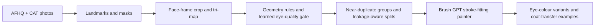
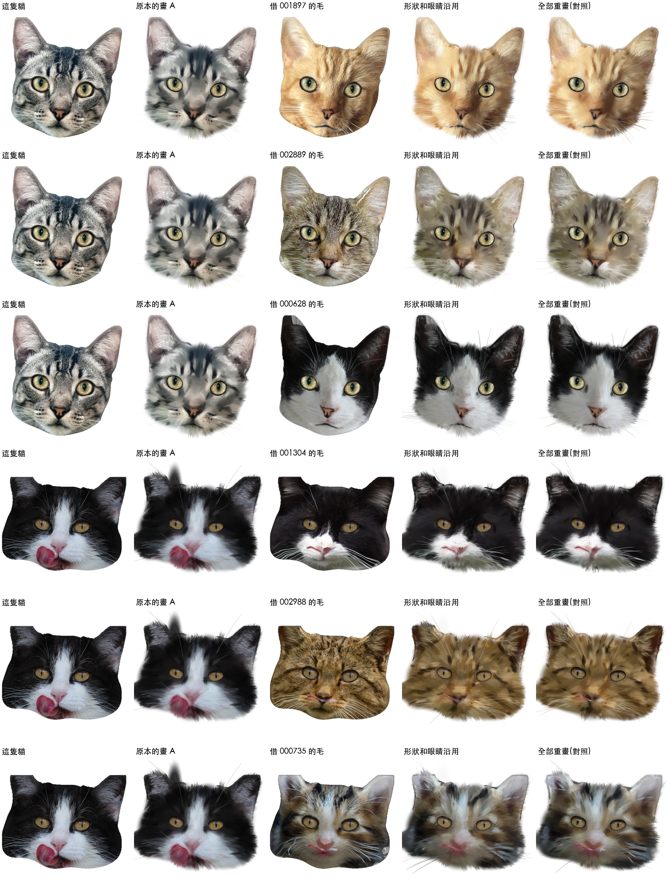

# Photo-to-Painting Dataset

[](https://github.com/alina0607/photo-to-painting-dataset/actions/workflows/ci.yml)

A data-curation pipeline for a cat-portrait painting system that represents paintings as ordered brush strokes. The collection contains 15,512 photos from AFHQ v2 (5,558) and the CAT dataset (9,954). This repository prepares face geometry, evaluates image quality, identifies near-duplicates, and supports leakage-aware evaluation.

This project treats data quality as part of model engineering. Real photos vary in framing, lighting, visibility, masks, and duplication. The current checks cover geometry, visibility, eye-detail quality, duplicates, and painting integrity. **General-purpose blur and yellow-colour-cast detectors are not implemented yet.**

> **Scope and attribution:** This repository implements face preparation, deterministic quality checks, eye-quality evaluation, duplicate grouping, and painting-integrity checks. The companion painter and coat-transfer prototype are in [Brush GPT](https://github.com/alina0607/brush-gpt) and [BidGPT](https://github.com/alina0607/BidGPT). CLIP and SAM pretrained weights and third-party libraries are reused; the feature pipelines, logistic-regression classifier, sketch-planning integration, stroke-fitting painter, and coat-transfer orchestration are project code. Coat-transfer examples exist; full-scale data generation and a learned interactive edit model remain in progress.

## Workflow



| Stage | Implementation | Purpose |
|---|---|---|
| Source data | AFHQ v2 cat faces; CAT dataset photos with masks and hand-placed landmarks | Combine aligned face crops with a source providing labeled geometry |
| Landmark transfer | [Cat Face Landmarks](https://github.com/alina0607/cat-face-landmarks) | Predict two eyes, mouth, and three points per ear for AFHQ images |
| Face preparation | `photo2painting.ingest` | Build a face-relative crop and background/head/uncertain tri-map at 256 × 256 |
| Geometric checks | `photo2painting.rules` | Detect cut-off faces, weak masks, small or low-contrast eyes, and missing ears |
| Eye-quality classifier | `photo2painting.eye_quality` | Combine CLIP crop embeddings and measured eye features with project-trained logistic regression |
| Label reliability | `photo2painting.agreement` | Measure annotator agreement using Cohen’s kappa |
| Duplicate control | `photo2painting.duplicates` | Group near-identical photos and keep groups within one split |
| Painting integrity | `photo2painting.integrity` | Detect canvases or strokes containing NaN or infinity |

## Landmark model: project implementation and measured result

CAT provides nine hand-placed points per image; AFHQ has aligned 512 × 512 cat-face crops but no landmarks. [Cat Face Landmarks](https://github.com/alina0607/cat-face-landmarks) implements a PyTorch Vision Transformer encoder and masked-autoencoder (MAE) pretraining/fine-tuning pipeline, based on published ViT/MAE methods. It is **not** a downloaded pretrained landmark model. The model predicts left/right eye, mouth, and outer-base/tip/inner-base points for each ear, then transfers this geometry to AFHQ faces.

On a held-out 1,000-image CAT test split, MAE pretraining improved normalized mean error from 0.0780 to 0.0670 and failure rate from 21.4% to 12.2%, compared with the same model trained from random initialization. It predicts landmarks; it does not predict nose position or classify image quality.

## Face-relative preparation

The eye midpoint defines the origin, the eye line defines horizontal, and the mouth defines downward direction. The source photo is not rotated. A rounded head shape is constructed from landmarks and intersected with the subject mask. The resulting 256 × 256 crop uses a tri-map: 0 for background (replaced with white paper), 1 for cat head, and 2 for uncertain pixels, including mask outside the head or areas beyond the source image. This avoids unrelated background while retaining boundary uncertainty.

## Quality checks by modeled part

Eligibility is tracked separately for the full head, each ear, eyes, nose/mouth, and fur: a photo can be useful for one part but not another.

### Deterministic geometry and visibility

Implemented checks include at least 97% face-hull coverage by the subject mask, at least 40 px between eyes, at least 0.035 luminance standard deviation near eyes, and ear bases at least 20 px wide with the relevant region present. These rules catch incomplete framing, face areas that would become paper, hidden or too-small ears, undersized eyes, and insufficient eye contrast.

### Learned eye-quality classifier

A person labels examples as clear or unclear. The project-written feature pipeline combines CLIP embeddings from three eye crops (both eyes and each eye separately) with measured eye size, left/right size imbalance, iris lightness and colour differences, and pupil contrast. A project-trained scikit-learn logistic-regression model estimates whether the eye pair is unclear.

The image encoder is OpenAI’s pretrained `openai/clip-vit-base-patch32`; it is an external frozen feature extractor, not a model trained in this project. Project code implements crop generation, feature assembly, labels, evaluation, and threshold analysis. Stratified cross-validation produces out-of-fold scores; threshold choice is nested within training folds, and bootstrap intervals quantify uncertainty. Labeled failure types include grainy eyes, flash eye-shine, a hidden eye, grayscale, small squinted eyes, and shadows that make the eyes disagree.

A historical five-fold evaluation on 435 hand-labeled cats recorded 0.795 accuracy and 0.890 ROC AUC. This is a CLIP-feature-plus-measurements classifier, **not** a separately trained deep-learning quality model. The current filters do not include general blur or yellow-cast detectors; those need labels and evaluation before being claimed as implemented.

## Duplicate control and evaluation integrity

The duplicate search first generates candidates using thumbnail correlation (including mirrored images), DCT perceptual-hash distance, and optionally CLIP similarity. It then aligns scale/shift and compares normalized cross-correlation, SSIM, and RGB difference. Confirmed copies are grouped and each group stays on one side of a train/validation/test split, reducing the chance that near-copies inflate held-out scores.

## Painting and editing (companion projects)

[Brush GPT](https://github.com/alina0607/brush-gpt) contains a project-written differentiable painter that fits parameterized strokes to a cat photo. Seven stages build the block-in, eyes, form, edges, markings, nose/mouth, and ears/whiskers; gradient descent fits stroke position, size, angle, colour, and opacity through the renderer. The Brush GPT transformer is implemented in PyTorch.

### Sketch planning and external model attribution

The project-written planner in [Brush GPT’s plan.py](https://github.com/alina0607/brush-gpt/blob/main/brushgpt/plan.py) prepares prompts/crops, calls Meta’s pretrained Segment Anything model `facebook/sam-vit-base` through Hugging Face Transformers for prompted eye and nose masks, and processes contours into a sketch plan. Mouth structure is derived from the image. SAM weights and the Transformers library are external components; the prompt, crop, contour, and planning logic is project code.

### Fur direction and eye-colour variants

The project-written fur-direction field blends an anatomy prior (radiating from the nose, following the face around the eyes, and pointing outward through the ears) with local hair texture measured using a structure tensor. Doubled-angle vectors represent undirected brush strokes. Near eyes and nose, local image structure guides the field instead of treating facial texture as fur.

Brush GPT can recolour left and right eyes independently using colour measurements from labeled real cat eyes. It changes iris hue while preserving lightness and shading, then refits only eye layers; pixels outside the eye region remain unchanged. These controlled variants and mirrored examples create additional training sequences without representing them as new source photographs.

### Cross-cat coat-transfer prototype

A working prototype in [BidGPT’s coat_versions.py](https://github.com/alina0607/BidGPT/blob/main/ml/tools/coat_versions.py) creates donor-coat examples. It piecewise-affine warps donor fur onto a recipient, anchored by eyes, mouth, and sampled head/ear outline. It excludes donor facial features and background, preserving the recipient’s eyes, nose, and mouth. The prototype retains the original painting’s shape-layer stroke geometry and eye strokes, refits retained shape colours, and repaints transferred fur details. It also produces a full-repaint comparison.

The figure shows six current examples. Coat transfer is implemented as a prototype; broader dataset generation and a learned interactive edit model remain in progress. This code is in BidGPT, not this repository.



The learned generator also supports coat-base and coat-pattern conditions. It should not yet be described as a completed model that can reliably apply an arbitrary donor coat to any cat.

## Data sources and terms

| Source | Photos | Annotations | Terms |
|---|---:|---|---|
| [AFHQ v2](https://github.com/clovaai/stargan-v2), cats | 5,558 | Landmarks predicted by Cat Face Landmarks | CC BY-NC 4.0 |
| [CAT dataset](https://archive.org/details/CAT_DATASET) | 9,954 | Subject masks and hand-placed nine-point landmarks | Research use only |

Source images are not redistributed here. Figures use AFHQ images only; AFHQ is distributed under CC BY-NC 4.0 by its authors.

## Development and CI

```bash
uv sync
uv run pre-commit install
uv run pytest
SELL_ANYTHING_ML=/path/to/BidGPT/ml uv run pytest
```

GitHub Actions runs Ruff formatting and lint, mypy, pytest, and a generated class-diagram consistency check on pushes. Synthetic tests run in CI; equivalence tests against the original research implementation run when `SELL_ANYTHING_ML` points to that source tree.
