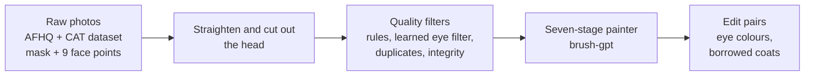

# Photo to Painting Dataset

[](https://github.com/alina0607/photo-to-painting-dataset/actions/workflows/ci.yml)

How 15,512 cat photos become a dataset of stroke-by-stroke paintings: reading the raw
photos, straightening and cutting out each head, measuring and filtering out the photos
that cannot teach a painting model, painting the rest in seven stages, and making
before/after pairs for learned edits (another eye colour, another cat's coat).

The paintings train [Brush GPT](https://github.com/alina0607/brush-gpt), a transformer
that paints a cat one brush stroke at a time; this repository is the data side, written
up as a data-science case study: every filter is a decision with a measured cost.

> **Status:** work in progress. Each section below is filled in as its code lands, with
> every number taken from a run.

## Pipeline



| Step | Module | What it decides | Status |
|---|---|---|---|
| Raw photos | `photo2painting.ingest` | which photos and face points come in | done |
| Straighten and cut out | `photo2painting.ingest` | the head in the face's own frame, on a 256 px grid with a background / head / uncertain map | done |
| Rule filters | `photo2painting.rules` | face cut off, too dark, eyes too small, ears cut or outside the photo | done |
| Learned eye filter | `photo2painting.eye_quality` | cats whose eyes are too poor to paint from (CLIP features + logistic regression; cross-validated, bootstrap intervals, nested threshold choice) | done |
| Label agreement | `photo2painting.agreement` | whether a hand-labelled standard is reliable enough to judge a classifier (Cohen's kappa) | done |
| Duplicates | `photo2painting.duplicates` | near-duplicate photos and a split that keeps each group of copies on one side | done |
| Integrity | `photo2painting.integrity` | paintings with any non-finite number | done |
| Coat reader | | the coat's base colour and pattern as a condition, only when confident | planned |
| Painting | uses `brushgpt.painter` | seven stages, eyes apart | planned |
| Edit pairs | | eye-colour versions and borrowed coats, with the unchanged parts checked stroke for stroke | planned |
| Case-study notebook | | the whole pipeline on one cat and on the dataset, with results | planned |

## Design

- **Reuse, not copies.** The painter, the prepared cat and the attribute readers live in
  [brush-gpt](https://github.com/alina0607/brush-gpt) and are a pinned dependency here.
- **Equivalence tests.** The code was first written as research scripts. Each module
  here has tests that run the research code on the same real cat and require the same
  output (pixel for pixel, or the same AUC); they run when `SELL_ANYTHING_ML` points at
  the research repository's `ml` folder and are skipped otherwise. Synthetic tests run
  everywhere, including CI.
- **The photo is never rotated for painting.** "Straightening" means drawing the head's
  shape in the face's frame (eyes at (-0.5, 0) and (0.5, 0)); only the eye-quality crops
  are rotated, because a tilted head's eyes would fall out of a fixed crop.

## Data and licences

| Source | Photos | Face points | Licence |
|---|---|---|---|
| [AFHQ v2](https://github.com/clovaai/stargan-v2) (cats) | 5,558 face crops | predicted by [cat-face-landmarks](https://github.com/alina0607/cat-face-landmarks) | CC BY-NC 4.0 |
| [CAT dataset](https://archive.org/details/CAT_DATASET) | 9,954 with a subject mask | hand-placed | research use only |

No photo of the CAT dataset is included in this repository. Derived features and labels
will be published as release assets; figures use AFHQ cats only.

## Development

```bash
uv sync                      # Python 3.11+, locked dependencies
uv run pre-commit install     # lint, format, type-check and diagram on every commit
uv run pytest                 # synthetic tests
SELL_ANYTHING_ML=/path/to/BidGPT/ml uv run pytest   # plus the equivalence tests
```

CI runs ruff (lint and format), mypy, pytest and checks that the class diagram in
`docs/` is up to date on every push.
